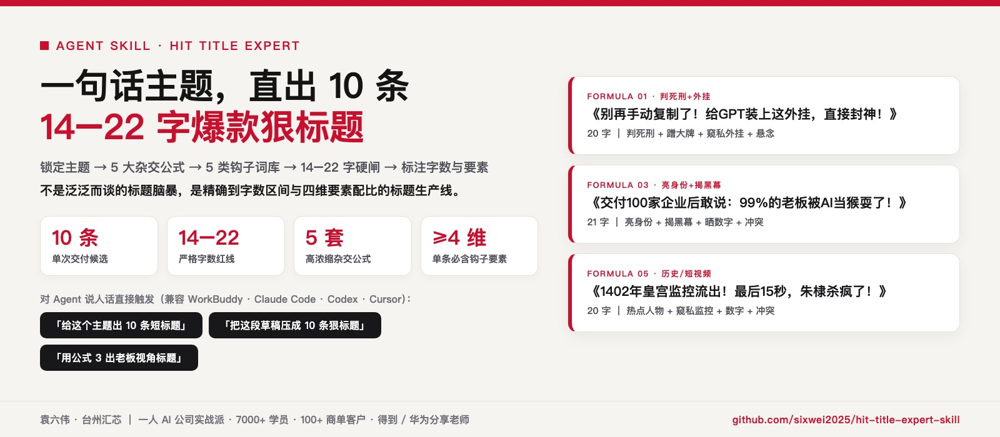
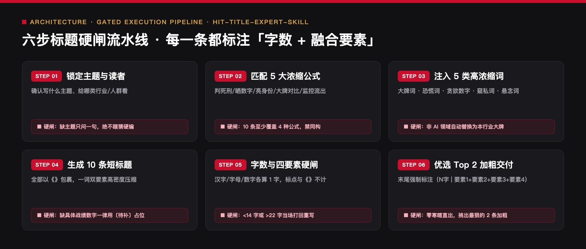

<div align="center">



# 爆款标题专家 Skill
### `hit-title-expert-skill` · 一次直出 10 条 14–22 字高浓缩狠标题的工程化起题器

[](https://agentskills.io)
[](#五30-秒安装与挂载)
[](#三5-大高浓缩杂交公式与废稿对照)
[](LICENSE)

> 🔴 **作者：袁六伟 · 台州汇芯**｜一人 AI 公司创业者，学员 7000+，客户 100+，得到 / 华为分享老师  
> 📮 更多 AI 工具实测与自动化实战，关注 **公众号 / 视频号：袁六伟**

**不是泛泛而谈的「帮我想几个标题」，是一套守住字数红线（14–22 字）与四维钩子密度的起题生产线。**  
把一个主题或一段草稿丢给 Agent，一次拿到 **10 条 14–22 字** 的短平快狠标题，逐条标注字数与融合要素，并自动加粗最值得先发的 Top 2。全行业通用（职场、电商、教培、历史科普、母婴、财经、AI）。

```bash
# 方式 A：通过 skills CLI 一键安装（推荐）
npx skills add sixwei2025/hit-title-expert-skill

# 方式 B：克隆到本地 Agent Skills 目录
git clone https://github.com/sixwei2025/hit-title-expert-skill.git ~/.claude/skills/hit-title-expert
```

[为什么长标题没人点](#一为什么普通-ai-写的标题没人点) · [六步起题流水线](#二六步起题流水线) · [5 大浓缩公式](#三5-大高浓缩杂交公式与废稿对照) · [5 类钩子弹药库](#四五类高浓缩钩子词库跨行业替换法则) · [安装配置](#五30-秒安装与挂载)

</div>

## 版本记录

当前版本：`v1.0.0` · 2026-11-13
完整变化记录见 [CHANGELOG.md](CHANGELOG.md)。


## 新手安装：把链接发给 AI

打开 Codex、WorkBuddy，或其他支持技能安装的 AI 智能体，把下面这段话直接发到对话框，让它帮你安装：

```text
帮我安装这个仓库里的技能：
https://github.com/sixwei2025/hit-title-expert-skill
```

不需要自己先敲安装命令，按 AI 的提示完成即可。安装后可以接着问：“这个技能怎么用？带我做一个最简单的例子。”

需要使用能够读取仓库、操作本地文件并支持技能安装的 AI；如果当前平台不支持，它可以提供手动安装指引。部分技能还需要额外软件或账号配置，安装技能与完成这些配置是两步，按本页说明和 AI 提示继续。


---

## 一、为什么普通 AI 写的标题没人点？

平时让大模型起标题，十有八九给你吐出一串 28–35 字的温吞水长句：
- ❌ 废稿例 1：《还在手动复制聊天记录？难怪你的 GPT 越用越蠢，快用这个插件》（27 字，手机列表直接被截断一半，毫无重点）
- ❌ 废稿例 2：《跑完 100 家企业交付后，我撕开 AI 圈最大的遮羞布，老板们都不会用》（29 字，铺垫太长，读者划过去只需 0.3 秒）

真正高点击率的公众号与短视频标题，必须在 **14–22 个字** 的黄金视觉宽度内，用「一词双要素」的高浓缩词同时引爆 **4 个以上钩子**。本 Skill 把这套实战手感写成了四条把关标准：

| 把关维度 | 传统提示词起题 | `hit-title-expert-skill` 质量标准 |
| :--- | :--- | :--- |
| **字数控制** | 动辄 25–35 字，手机端折行截断 | **严格控制在 14–22 字**（汉字/字母/数字各算 1 字，标点与《》不计；超 1 字当场重写） |
| **信息密度** | 大量连接词、形容词、慢热铺垫 | **每条必融 ≥4 个钩子要素**（蹭大牌 / 判死刑 / 晒数字 / 窥私外挂 / 悬念） |
| **结构多样性** | 10 条标题长相雷同，换汤不换药 | **10 条至少覆盖 4 种杂交公式**，末尾强制打印 `（N字 | 要素1+要素2+要素3+要素4）` |
| **事实诚实度** | 随意编造「年入千万」「10万用户」 | **缺具体战绩一律用 `〔待补〕` 占位**，绝不替用户捏造虚假数字 |

---

## 二、六步起题流水线

<p align="center">
  
</p>

直接对你的 Agent 说这几句话即可驱动：

| 你对 Agent 说 | Agent 执行动作与交付物 |
| :--- | :--- |
| **「用爆款标题专家，给这个主题出 10 条短标题：……」** | 走完 6 步流程，交付 **10 条 14–22 字标题 + 字数/要素验算标 + 加粗 Top 2 首选** |
| **「把这段草稿压成 10 条狠标题，给门店老板看」** | 自动将词库切换为实体商业/门店语境，剔除 AI 圈黑话，输出 10 条老板视角短标题 |
| **「用公式 5（监控流出）给司马光砸缸出 5 条短视频标题」** | 针对历史/人物/短视频场景，输出带强烈现场感与反差感的 14–20 字标题 |

---

## 三、5 大高浓缩杂交公式与废稿对照

本仓库在 [`GUIDE.md`](GUIDE.md) 中内置了 5 套经过实战检验的四维/五维杂交公式：

| 公式编号 | 要素组合 | 啰嗦废稿（传统 AI 写法） | 本 Skill 浓缩成品（14–22 字精炼） |
| :---: | :--- | :--- | :--- |
| **公式 01** | **判死刑 + 蹭大牌 + 窥私外挂 + 悬念** | 《还在手动复制聊天记录？难怪你的GPT越用越蠢，快用这个插件》 | **《别再手动复制了！给GPT装上这外挂，直接封神！》**（20字） |
| **公式 02** | **蹭热点 + 晒数字 + 起贪欲 + 造冲突** | 《Claude被封号之后，我用三个免费的AI工具搭建了工作流产能暴涨》 | **《砍掉20万外包！我靠1个野生AI，产能反超5倍！》**（20字） |
| **公式 03** | **亮身份 + 揭黑幕 + 晒数字 + 留悬念** | 《跑完100家企业交付后，我撕开AI圈最大的遮羞布，老板们都不会用》 | **《交付100家企业后敢说：99%的老板被AI当猴耍了！》**（21字） |
| **公式 04** | **大牌对比 + 起爽欲 + 留悬念 + 造冲突** | 《为什么有了Obsidian这个超级大脑，我还要强推这个不起眼的小插件》 | **《有了Obsidian，为何高手还在偷偷白嫖这"外挂"？》**（21字） |
| **公式 05** | **热点人物 + 窥私监控 + 造冲突 + 晒数字** | 《公元1402年皇宫监控流出，建文帝死前最后15秒看懂朱棣如何夺位》 | **《1402年皇宫监控流出！最后15秒，朱棣杀疯了！》**（20字） |

### 跨行业通用验证（绝不仅限于 AI 选题）
- **教培行业**：《别再手抄教案了！给课件挂上这外挂，直接封神！》（19字｜判死刑+场景+外挂+爽感）
- **实体门店**：《门店砍掉3个兼职！我靠1条短视频，客流翻倍！》（20字｜造冲突+晒数字+低成本+结果）
- **知识付费**：《带过200个学员后敢说：99%的人不会写标题！》（20字｜亮身份+晒数字+揭黑幕+冲突）

---

## 四、五类高浓缩钩子词库（跨行业替换法则）

为了在 20 字内塞进 4 个要素，[`GUIDE.md`](GUIDE.md) 提供了五类「一词双要素」弹药库，并支持按行业自动映射：

1. **【大牌 / 热点词】**：AI 圈用 `GPT / Claude / DeepSeek`；历史圈换 `朱棣 / 司马光 / 曹操`；商业圈换 `胖东来 / 蜜雪 / 苹果 / 拼多多`。
2. **【冲突 + 恐慌词】**：`封号 / 卸载 / 沦为废铁 / 智商税 / 别再 / 干翻 / 砍掉`。
3. **【贪欲 + 数字词】**：`白嫖 / 0成本 / 暴涨5倍 / 1个人顶20人 / 省下20万`。
4. **【窥私 + 爽感词】**：`外挂 / 后门 / 野路子 / 遮羞布 / 监控流出 / 爽麻了 / 作弊`。
5. **【悬念钩子词】**：`居然靠这招？ / 绝了！ / 真相后背发凉 / 只做这1件事…`。

---

## 五、30 秒安装与挂载

遵循 [Agent Skills](https://agentskills.io) 开放标准，兼容所有主流 AI 编程与创作智能体：

```bash
# 1. 使用 npx skills 一键安装
npx skills add sixwei2025/hit-title-expert-skill

# 2. 或手动软链到你的 Agent 目录
git clone https://github.com/sixwei2025/hit-title-expert-skill.git
ln -s "$PWD/hit-title-expert-skill" ~/.workbuddy/skills/hit-title-expert
ln -s "$PWD/hit-title-expert-skill" ~/.claude/skills/hit-title-expert
ln -s "$PWD/hit-title-expert-skill" ~/.codex/skills/hit-title-expert
```

---

## 六、仓库目录结构

```text
hit-title-expert-skill/
├── SKILL.md                           # 【总控入口】6 步起题主流程、字数计算规则与失败降级策略
├── GUIDE.md                           # 【弹药库】5 大杂交公式、废稿对照表、5 类浓缩词库与非 AI 行业示例
├── skill-avatar-512.jpg               # Skill 图标资产
├── assets/
│   └── showcase/                      # README 视觉展示图集（Hero 横幅与六步起题架构图）
├── LICENSE                            # MIT 开源许可
└── NOTICE                             # 归属声明
```

---

## 关于作者与开源生态

**袁六伟 · 台州汇芯**：一人 AI 公司创业者，学员 7000+，服务商单客户 100+，覆盖近 20 个行业，得到 / 华为分享老师。AI 变现实战派，自己跑通才拿出来教。

- 公众号：**袁六伟**（微信搜一搜关注，看更多 AI 工具实测与一人公司实战）
- 视频号：**袁六伟**

这个项目免费开源。如果它帮你的产线省下了每天反复返工的时间，欢迎在右上角点个 ⭐ **Star**，也欢迎转发给身边做内容或一人公司的朋友。

### 同系列开源 Skill 矩阵（袁六伟 · 台州汇芯）

| 仓库 | 领域 | 核心能力 |
| :--- | :--- | :--- |
| [**workbuddy-wechat-autopilot**](https://github.com/sixwei2025/workbuddy-wechat-autopilot) | 公众号全链路 | 九步全自动总控：选题→写稿→真实截图→6套封面→6套排版→三重自动质检→草稿箱 |
| [**wechat-cover-skill**](https://github.com/sixwei2025/wechat-cover-skill) | 公众号视觉 | 封面渲染引擎（6套高客单价杂志风 + 黑红金 v2b + 防压脸自动校验） |
| [**gzh-million-layout-skill**](https://github.com/sixwei2025/gzh-million-layout-skill) | 公众号排版 | 汇芯红 `#C8102E` 六套 100% 内联 CSS 骨架 + 零乱码检查 + 配图皮肤 |
| [**ai-tool-review-wechat-skill**](https://github.com/sixwei2025/ai-tool-review-wechat-skill) | 公众号评测 | AI 工具真跑评测工作流（2.0 全自动压测 + 去碎句语感质检 + 六套骨架装配） |
| [**hit-title-expert-skill**](https://github.com/sixwei2025/hit-title-expert-skill) | 爆款标题 | 一次直出 10 条 14–22 字高浓缩狠标题（5大公式 × 5类钩子词） |
| [**auto-tutorial-skill**](https://github.com/sixwei2025/auto-tutorial-skill) | 短视频工程 | 链接/网页/真机截图 → 3:4 封面 + 1.5x 配音 + 红框标注教程视频 |
| [**talking-head-video-skill**](https://github.com/sixwei2025/talking-head-video-skill) | 短视频工程 | 1080×1920 竖屏真人口播短视频（ASR 错字校对 + 逐字卡拉OK字幕 + 6项QC） |
| [**3d-map-video-skill**](https://github.com/sixwei2025/3d-map-video-skill) | 短视频工程 | MapLibre 3D 地形 + WarFX 战争特效（粒子行军/点阵兵力/震屏混音） |
| [**psych-kepu-video-skill**](https://github.com/sixwei2025/psych-kepu-video-skill) | 短视频工程 | Remotion + JSON 驱动的 15–30s 深色扁平动画心理科普短视频 |
| [**dark-infographic-video-skill**](https://github.com/sixwei2025/dark-infographic-video-skill) | 短视频工程 | 纯 Python + FFmpeg 暗黑流光数据可视化科普片（含 v2 手机外放配乐） |
| [**local-video-hub**](https://github.com/sixwei2025/local-video-hub) | AI 团队基建 | 视频版本地 Obsidian：多 AI 员工统一交片、撞题查重与四态流转云台 |
| [**yuanliuwei-ai-skills**](https://github.com/sixwei2025/yuanliuwei-ai-skills) | 一人公司方法 | PACT 72h 需求验证模型与一人 AI 公司 10 大业务决策模块 |
| [**book-skill**](https://github.com/sixwei2025/book-skill) | 知识工程 | 上传任意书籍 PDF → 自动提炼方法论生成 `.skill` + 公众号导流文案 |
| [**huangdi-skill**](https://github.com/sixwei2025/huangdi-skill) | 认知操作系统 | 中国历史八大皇帝（秦始皇/汉武帝/唐太宗等）一手史料认知框架蒸馏 |
| [**sunrise-tracker**](https://github.com/sixwei2025/sunrise-tracker) | 选题雷达 | 小红书 AI 赛道 10 倍异常流量「低粉爆文」每日早 7 点监测推送 |
